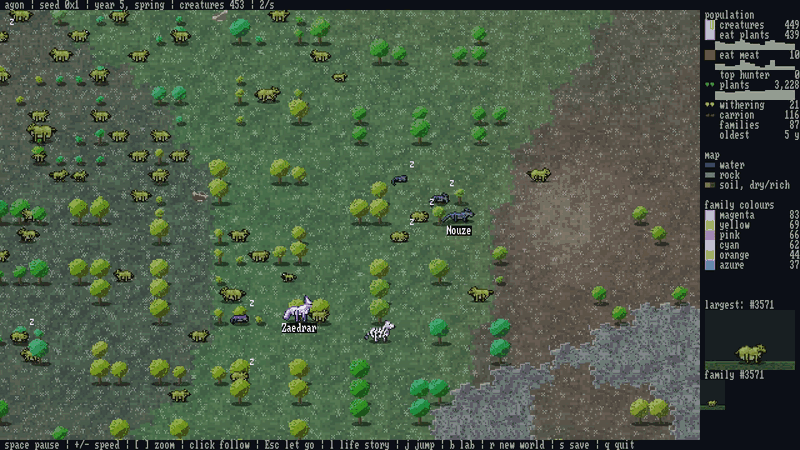

# agon

*agon* (ἀγών): Greek for struggle or contest.

A terminal world where nobody decides who wins. Terrain is generated from a
seed, vegetation spreads by neighbour rules that it inherits, and creatures
with inherited neural-network brains graze, hunt, scavenge, reproduce and die.
Food chains, population swings and families of related creatures are not
programmed in; they emerge.



Written in C11 with no dependencies beyond the C standard library and POSIX.
Leave it running in a terminal, or have it print one snapshot of a world and
exit.

## Build and run

You need a C compiler and `make` on Linux.

```sh
make release
./build/release/agon
```

To install it (default `/usr/local`, change it with `PREFIX`):

```sh
sudo make install
sudo make uninstall
```

`make test` runs the tests with the memory checkers on.

The display uses 24-bit colour and two square pixels per character cell, so
it wants a terminal with true colour and a font with the half-block character.

## In a window

`agon-window` shows the same simulation drawn in tiles, in the classic Dwarf
Fortress style, with bodies generated from each creature's genes. It needs SDL 2;
nothing else in agon does, and `make` and `make test` work without it.

```sh
sudo apt install libsdl2-dev   # on Debian and Ubuntu
make window MODE=release
./build/release/agon-window
```

The default world is 256x144 cells. `--seed`, `--size`, `--speed`, `--no-floor`,
`--config`, `--save` and `--load` work as they do below, and save files are shared
by both programs. `--zoom close|normal|far|world` picks the starting zoom.

| Key or mouse | What it does |
|---|---|
| space | pause |
| `+` `-` | faster, slower |
| wheel, `[` `]` | zoom |
| dragging, arrows | move the view |
| clicking a creature | follow it: the panel shows it, its body enlarged, and its family's bodies over time |
| clicking "top hunter", "oldest" or the largest family's body on the panel | follow the highest on the food chain, the oldest, or that family's biggest |
| Esc, clicking bare ground, moving the view | let go |
| `r` | a new world from a new seed |
| `n` | a new world, after game over |
| `s` | save, if started with `--save` |
| `q`, the window's X | quit (and save, if started with `--save`) |

### On Windows

Download `agon-window-windows.zip` from the
[latest release](https://github.com/Nickrosendo/agon/releases/latest), unpack it and
run `agon-window.exe`; the DLLs it needs are beside it. The program is not signed, so
Windows may warn about it first. To build it yourself, in
MSYS2's MINGW64 shell with `mingw-w64-x86_64-gcc`, `mingw-w64-x86_64-SDL2` and
`make` installed:

```sh
make window MODE=release PLATFORM=windows
```

Only the window program exists on Windows; the terminal program needs POSIX. It
is a windowed program with no console, so `--help` shows nothing when run from
`cmd`: use `agon-window --help | more`. A save or a seed's world made on one
system may not match another's, because maths functions differ between them.

### In a browser

**[Run it here](https://nickrosendo.github.io/agon/)**, with nothing to install. The
page always holds the latest version. To build it yourself, with
[Emscripten](https://emscripten.org) set up:

```sh
make web
python3 -m http.server -d build/web 8000   # then open http://localhost:8000
```

The page needs a web server: browsers refuse to load its code from a plain file.
Add `?seed=3` to the address for a particular world. There is no saving here, so
refreshing loses the world, and a hidden tab runs slowly and does not catch up.

## Keys

These are for the terminal program, `agon`.

| Key | What it does |
|---|---|
| space | pause |
| `+` `-` | faster, slower |
| `r` | a new world from a new seed |
| `n` | a new world, after game over |
| `i` | inspect: arrows or `hjkl` move the cursor (`HJKL` by 5), and the panel shows the plant and creature under it |
| `s` | save, if started with `--save` |
| `q` | quit (and save, if started with `--save`) |

## Options

```
--seed N       the world's seed: a whole number, or 0x hexadecimal
--size WxH     world size in cells (default: fit the window; 80x40 with --once)
--speed N      ticks per second (default 10)
--once         print one snapshot after --ticks ticks and exit
--ticks N      ticks to run before the snapshot (default 2000)
--no-floor     turn off a floor a settings file set
--config PATH  read settings from a file
--save PATH    write the world there on quit and on s
               (with --once: after the last tick)
--load PATH    resume a saved world
--settings     print every setting and its default, and exit
-h, --help     help
--version      the version
```

The same seed and settings give the same world, tick for tick, on the same
build. A snapshot works anywhere, even in a pipe:

```sh
agon --once --seed 3 --ticks 5000 --size 100x60
```

Ctrl-C ends the program without saving; only `q` and `s` save.

## Settings

Every number in the simulation can be changed from a text file:

```sh
agon --config my.conf
```

```ini
# my.conf: lines are name = value; anything left out keeps its default
mutation_rate = 0.1
max_age = 3000
```

[`agon.conf.example`](agon.conf.example) lists all of them with their defaults
and ranges (`agon --settings` prints the same list). A mistake stops the
program with the file's name, the line number and what was wrong.

A save file holds its world's settings, seed and size, so `--load` cannot be
combined with `--config`, `--seed`, `--size` or `--no-floor`. Save files are
for the build that wrote them; a build with a different format refuses them.

## How the world works

1. Cells are water, rock or soil, from noise that wraps around the edges. Soil
   has a fertility.
2. Every plant carries its own rule: how many planted neighbours let an empty
   cell sprout, and how much crowding it tolerates. A sprout copies a planted
   neighbour's rule, sometimes with one bit flipped.
3. Vigorous rules spread faster, but they feed less and die younger. Plants
   age, wither and leave bare soil.
4. Each creature inherits a genome: its size at birth, speed, sight, digestion of
   plants and of meat, its colour, how fast it ages, its armour, weapon, growth and territory,
   and the weights of a small neural network.
5. Each tick, the network turns what the creature senses into one action: rest,
   turn left, turn right, move, bite, mate or attack.
6. Energy is the only currency. Living costs energy, and bigger, faster,
   farther-seeing bodies cost more, as does growing old, at a speed set by a
   gene. At zero, a creature dies and leaves carrion.
7. Two grown creatures side by side that both choose to mate have a child, and
   each pays for it with energy. Each part of its genome comes from one parent
   or the other, with small changes. No fitness function exists: what lives
   long enough to have children spreads. During the mating season, a quarter of
   each year, every fed adult is willing without choosing to be; outside it, both
   must choose, which is rarer.
8. Any creature can attack whatever stands right ahead of it, and biting only
   eats. Bigger attackers hit more often, and the odds rise for each other
   creature that has just hit the same target. A hit takes health, not energy.
   Wounds heal slowly and cost energy; with no energy left a creature loses health
   instead, and only health at zero kills. Kills become carrion, which rots away
   and sends out a scent.
9. A creature's food-chain level is measured from what it actually eats: a
   plant-eater sits at about 2, something that eats plant-eaters at about 3.
10. Random creatures appear only at the very start, and plants grow only from
    other plants. Nothing tops a world up, so a world can die. When the last
    creature dies the world stops and shows a game over screen with its year,
    seed and records. Nothing restarts by itself, so a world left overnight may
    be found dead. Small worlds die every time, since they get too few first
    creatures; `--size 256x144` gives a world a chance.
11. A creature can grow. Energy well above what mating needs is surplus, and a
    gene sets what share of it becomes body. There is no top size: bigger bodies
    hit harder, bite more and hold more health, and cost more to keep. Armour and
    a weapon are genes too, each with its own upkeep.
12. A creature carries a few numbers from one decision to the next, its memory,
    and also senses its hunger, its wounds, the relatives and strangers beside it
    and a random number. What it does with them is left to selection.
13. A creature does not strike a close relative. A newborn whose colour has
    drifted far from its family's starts a new family, and the old one stays safe
    from it for as long as the two remain close relatives. Resting costs half of
    what being busy does.
14. Creatures pay for being crowded, a little for each neighbour within two cells
    past the first, whoever those neighbours are. So staying packed together costs
    energy and spreading out saves it.
15. Territory is an inherited instinct. An adult with the gene sometimes turns on a
    stranger right beside it, whatever its brain chose, unless it chose to mate.
    Close relatives are safe.
16. Time is shown in years. A year is 100 ticks by default (`ticks_per_year`),
    which is only a way of showing time and changes nothing in a world.

## Licence

MIT
